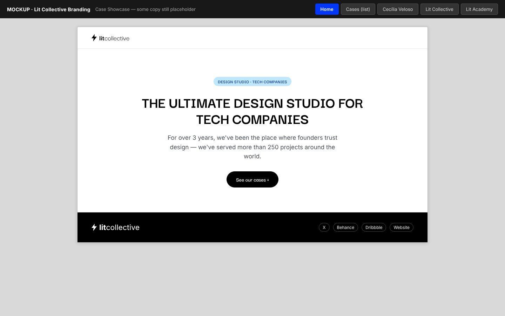
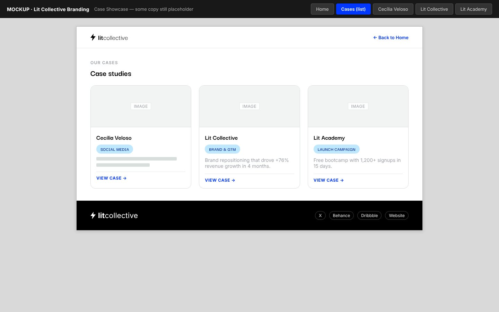
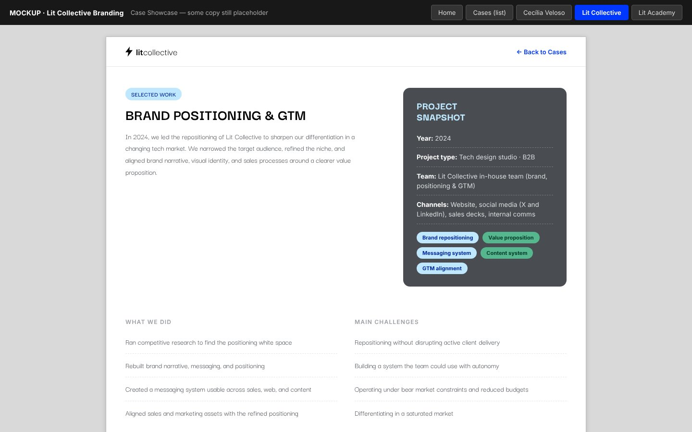
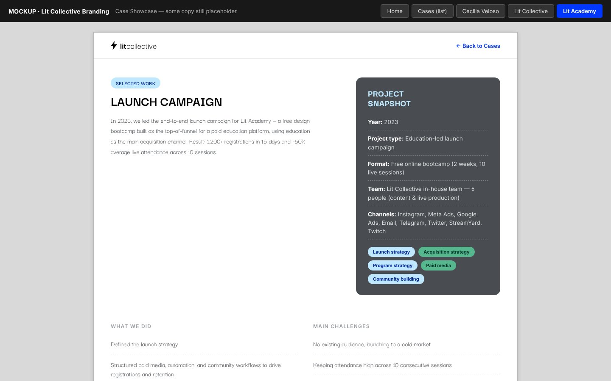

# Lit Collective — Case Showcase (Mockup)

A clickable mockup of a case-study showcase for Lit Collective, a design studio for tech companies: a home page, a list of cases and a detailed page for each case. Some copy is still placeholder.

**Live:** [lit-cases.vercel.app](https://lit-cases.vercel.app)



## What's inside

| Screen | What it shows |
| --- | --- |
| **Home** | The studio's positioning and a call to see the cases. |
| **Cases** | Cards for the three showcases, each with a tag and a one-line result. |
| **Lit Collective — Brand Positioning & GTM** | The 2024 repositioning: project snapshot, what was done, main challenges, services, client list and results. |
| **Lit Academy — Launch Campaign** | The 2023 free design bootcamp launch: snapshot, campaign assets, landing page traffic by channel and country, traffic spikes, Twitch live-session stats and results. |
| **Cecília Veloso — Social Media** | Case template, content still to come. |

A tab bar at the top switches between screens, and the page follows the Lit Collective brand palette.

<table>
  <tr>
    <td></td>
    <td></td>
  </tr>
  <tr>
    <td></td>
    <td align="center"></td>
  </tr>
</table>

## Built with

- Plain **HTML** and **CSS**, with a few lines of vanilla **JavaScript** for screen switching
- **Darker Grotesque** from Google Fonts
- Deployed on **Vercel**

## Project structure

```
.
├── index.html    # all screens: markup, styles, script and images
├── favicon.svg   # Lit Collective bolt
├── docs/         # screenshots used in this README
└── README.md
```

## Run locally

No install needed. Open `index.html` in a browser, or serve the folder:

```bash
npx serve .
```

## Contact

- [LinkedIn](https://www.linkedin.com/in/fl%C3%A1vio-veloso-a29b02254/)
- [X @flaviovlso](https://x.com/flaviovlso)
- [github.com/flaviohcveloso](https://github.com/flaviohcveloso)

---

© 2026 Flávio Veloso. All rights reserved.
